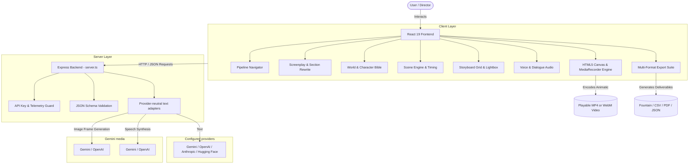

# SceneCraft

> **Turn an idea into a complete, structured content production pipeline.**

[](tests/)
[](tsconfig.json)
[](package.json)
[](LICENSE)

---

## Live Demo

- **Application URL**: [https://ais-dev-kkxb7ks27a5svkbrvivdvi-968640885885.asia-southeast1.run.app](https://ais-dev-kkxb7ks27a5svkbrvivdvi-968640885885.asia-southeast1.run.app)
- **Pre-Loaded Demo**: Explore the pre-loaded short film project *"The Last Signal"* without requiring an API key.

---

## Overview

Modern generative AI tools often treat content generation as disconnected chat prompts. A writer gets a script in one tab, copies snippets into an image generator in another tab where characters change face and clothing every frame, and is left with no coherent way to organize scenes, record voiceovers, or generate an animatic pitch.

**SceneCraft** solves this by establishing a disciplined, sequential **8-stage production pipeline**:

```
Idea → Project Config → Screenplay → World Bible → Scenes → Storyboard → Voice Audio → Video Assembly → Export
```

Every stage produces validated, structured data that directly feeds the next step, ensuring that character traits, recurring environments, camera directions, and timing remain consistent.

---

## System Architecture



---

## The 8 Pipeline Stages

| Stage | Name | Key Functionality |
| :--- | :--- | :--- |
| **01** | **Project Setup** | Configure title, premise, format (Short Film, YouTube, Ad, Animation), duration, tone, and visual style. |
| **02** | **Screenplay** | Generates title, logline, synopsis, and full screenplay with scene headers. Supports selective single-section rewrites. |
| **03** | **World Bible** | Extracts characters, recurring locations, and props. Stores visual prompt markers for cross-scene consistency. |
| **04** | **Scene Engine** | Breaks down screenplay into sequential scenes with camera directions, actions, dialogue, mood, and durations. Reorder scenes with automatic renumbering. |
| **05** | **Storyboard** | Multi-state visual grid (`idle`, `generating`, `completed`, `failed`). Generates frames with Gemini or OpenAI image models, includes character references, lightbox inspection and single-frame downloads. |
| **06** | **Voice Audio** | Optional voiceover and dialogue synthesis through Gemini or OpenAI, with provider-specific voices. Non-blocking. |
| **07** | **Video Assembly** | Animatic player; browser-side Canvas `MediaRecorder` exports MP4 when supported, otherwise WebM, at the project's aspect ratio and mixes generated scene audio when present. |
| **08** | **Export Suite** | Fountain (`.fountain`), Markdown (`.md`), Plain Text, CSV scene breakdowns, printable PDF-ready storyboard, and full project backup JSON. |

---

## Tech Stack

- **Frontend**: React 19, TypeScript, Tailwind CSS, Lucide Icons, Vite
- **Backend / Server**: Node.js, Express, tsx
- **AI Providers**: Gemini, OpenAI, Anthropic Messages, and Hugging Face OpenAI-compatible text adapters; official `@google/genai` SDK for Gemini media generation
    - **Gemini text**: `gemini-2.5-flash`, `gemini-2.5-pro`
    - **OpenAI text**: `gpt-4.1-mini`, `gpt-4.1`, `o4-mini`
    - **Anthropic text**: Claude models from the authenticated model catalog
    - **Hugging Face text**: Qwen models and other models available through the HF Inference router
    - **Gemini image**: `gemini-2.5-flash-image`
    - **Gemini speech**: `gemini-2.5-flash-preview-tts`
- **Video Assembly**: HTML5 Canvas 2D, MediaStream Recording API (`MediaRecorder`), Web Audio API
- **Testing**: Node.js Native Test Runner (`node:test`, `node:assert/strict`)

---

## Getting Started

### Prerequisites
- Node.js `v20.x` or newer (`v22.x` recommended) and npm `v10.x` or newer.

### Fastest Codespaces Startup
The dev container installs the lockfile dependencies on creation and forwards port `3000`. In the Codespaces terminal, run:

```bash
npm run dev
```

Codespaces opens the forwarded app. The same process serves the Express API and Vite development UI; no second frontend process or proxy is needed. Readiness is available at `/api/health`.

### Local Startup
Install the locked dependencies once, then run the single full-stack server:

```bash
npm ci
npm run dev
```

Open `http://localhost:3000`. Without a key, the sample project and non-AI pipeline tools remain available in demo mode.

### Configure AI
Open **AI Settings** in the app header, choose Gemini, OpenAI, Anthropic, or Hugging Face, enter that provider's API key, and use **Test key** to verify provider access. Testing uses the provider's model-list endpoint; it does not generate content. Then save the provider, model, and thinking level. Qwen models are available through Hugging Face's inference router. Gemini and OpenAI provide image and speech generation; Anthropic and Hugging Face are text-only in SceneCraft. Media requests use the currently selected provider and never silently switch providers.

The settings screen supports key visibility, independent per-provider keys, live model discovery, and Low/Medium/High thinking controls only for models with a configured reasoning parameter. API-key status never exposes key contents. To keep web-entered keys after a server restart, configure the optional encrypted key vault described below.

You may instead configure server environment variables for unattended/headless startup. Copy `.env.example` to `.env` and set the provider's matching key (`GEMINI_API_KEY`, `OPENAI_API_KEY`, `ANTHROPIC_API_KEY`, or `HUGGINGFACE_API_KEY`/`HF_TOKEN`), optionally with `AI_PROVIDER`, `AI_MODEL`, and `PORT`. Environment keys are server-side defaults and are not returned to the browser.

---

## Running Tests & Verification

Automated tests cover pipeline data and mocked provider requests, credentials, model compatibility, thinking settings, retries, and malformed responses:

```bash
# Run unit test suite
npm test

# Run TypeScript linter
npm run lint

# Build for production
npm run build
```

For provider API details, project backup format, and known limitations, see [API documentation](docs/api.md), [architecture](docs/architecture.md), and the [troubleshooting guide](docs/troubleshooting.md).

---

## Environment Variables

| Variable | Required | Description |
| :--- | :--- | :--- |
| `GEMINI_API_KEY` | Optional | Gemini server-side fallback key. |
| `OPENAI_API_KEY` | Optional | OpenAI server-side fallback key. |
| `ANTHROPIC_API_KEY` | Optional | Anthropic server-side fallback key. |
| `HUGGINGFACE_API_KEY` / `HF_TOKEN` | Optional | Hugging Face server-side fallback token. |
| `AI_PROVIDER` | Optional | Default provider: `gemini`, `openai`, `anthropic`, or `huggingface` (defaults to `gemini`). |
| `AI_MODEL` | Optional | Default text model, validated against the provider list. |
| `PORT` | Optional | Full-stack server port (defaults to `3000`). |
| `SCENECRAFT_KEY_ENCRYPTION_KEY` | Optional | 32-byte AES-256-GCM key as 64 hex characters. Required to persist web-entered API keys securely. |
| `SCENECRAFT_KEY_STORE_PATH` | Optional | Encrypted vault file path (defaults to `.scenecraft/keys.json`). Use persistent private storage in deployment. |

### Key Storage and Limits
Generate an encryption key with `openssl rand -hex 32`, then save it as a Codespaces secret or deployment secret named `SCENECRAFT_KEY_ENCRYPTION_KEY`. Never commit it, place it in project backups, or store it beside the vault file. With the secret configured, web-entered provider keys and selected settings are stored in an AES-256-GCM authenticated-encryption vault, associated with the opaque `HttpOnly`, `SameSite=Strict` browser-session cookie, and expire 30 days after the last settings save. The default `.scenecraft/` directory is git-ignored; deployments must mount a private persistent volume if keys should survive container replacement. Back up the encryption secret separately: changing or losing it makes existing vault records unreadable. Without the secret, keys remain in server memory and are lost on restart. Keys are never returned by API endpoints, included in URLs, logged, or stored in browser project data.

Generation settings also live in server memory for that browser session. The server caps a session at 10 AI requests per minute and 100 per day, limits text prompts to 100,000 characters, image prompts to 10,000 characters, audio input to 1,000 characters, and provider output to 8,192 tokens. These are guardrails, not a substitute for provider billing limits. AI generation can incur charges.

### Provider and Thinking Support
Each provider's model selector can refresh against models enabled for the configured key. Low, Medium, and High map only to explicitly supported provider reasoning controls; unknown models receive no reasoning parameter. Gemini and OpenAI support image and speech; Anthropic and Hugging Face support text only.

---

## Project Structure

```
├── server.ts                  # Express API, session settings, and provider/media adapters
├── src/
│   ├── types/index.ts         # Canonical TypeScript interfaces (Project, Scene, WorldBible, etc.)
│   ├── services/
│   │   ├── api.ts             # Client API client calling Express backend
│   │   ├── storage.ts         # IndexedDB project and media persistence with migration
│   │   ├── keyVault.ts        # Encrypted server-side provider-key vault
│   │   └── serverMediaProviders.ts # OpenAI image and speech adapters
│   ├── utils/
│   │   ├── projectBackup.ts   # Versioned backup parsing, migration, and validation
│   │   ├── promptBuilder.ts   # Consistency engine weaving World Bible into scene prompts
│   │   ├── videoRenderer.ts   # HTML5 Canvas + MediaRecorder video assembly engine
│   │   ├── wav.ts             # PCM-to-WAV conversion for provider TTS
│   │   ├── exportUtils.ts     # Fountain, Markdown, CSV, and Printable Storyboard generators
│   │   └── sampleData.ts      # Pre-loaded "The Last Signal" short film demo project
│   ├── components/
│   │   ├── Header.tsx         # Workspace header, project switcher, save status indicator
│   │   ├── PipelineNav.tsx    # Sequential pipeline navigation bar
│   │   ├── ProjectModal.tsx   # Project configuration & settings modal
│   │   └── stages/
│   │       ├── ProjectOverview.tsx # Stage 01: Project overview & pipeline status
│   │       ├── ScriptStage.tsx     # Stage 02: Screenplay writer & section rewrite
│   │       ├── WorldBibleStage.tsx # Stage 03: World & Character Bible
│   │       ├── SceneStage.tsx      # Stage 04: Scene Engine & timing
│   │       ├── StoryboardStage.tsx # Stage 05: Visual Storyboard & image generator
│   │       ├── AudioStage.tsx      # Stage 06: Voice & speech synthesis studio
│   │       ├── VideoStage.tsx      # Stage 07: Video timeline & animatic assembler
│   │       └── ExportStage.tsx     # Stage 08: Export suite & archive manager
│   ├── App.tsx                # Master workspace coordinator
│   └── main.tsx               # Client entry point
├── tests/                     # Provider, pipeline, storage, backup, and WAV tests
├── docs/
│   ├── architecture.md        # Technical architecture & design rationale
│   ├── pipeline.md            # Detailed pipeline stage specifications
│   ├── api.md                 # API endpoints & request/response schemas
│   ├── troubleshooting.md     # Provider, storage, and rendering troubleshooting
│   └── PORTFOLIO.md           # Portfolio study, challenges, & solutions
├── CHANGELOG.md               # Version history
├── CONTRIBUTING.md            # Contribution guidelines
├── LICENSE                    # MIT License
└── package.json               # Dependencies & scripts
```

---

## Known Limitations

- **Media provider access**: Gemini and OpenAI adapters handle image and speech. Provider account entitlement, model access, and billing are still required. Anthropic and Hugging Face are text-only in SceneCraft.
- **Video codecs**: SceneCraft chooses MP4 only when the browser's MediaRecorder explicitly reports support; otherwise it exports WebM. Browser codec availability varies. Rendering runs at 30 fps in real time.
- **Project storage**: Projects and media use IndexedDB, with migration from legacy localStorage. Browser/device quotas still apply; export backups regularly. Rendered videos persist in the project database and are included in complete project JSON backups.
- **Audio Models**: Multi-speaker backchanneling is not implemented; single-speaker narration uses `gemini-2.5-flash-preview-tts`.
- **Screenplay history**: The editor keeps up to 50 project-local snapshots; edits are coalesced while typing.
- **Browser verification**: Automated browser codec playback depends on an installed browser/codec environment; unit tests verify encoder selection and mocked media responses.

---

## Roadmap

- [ ] Multi-speaker dialogue generation with scripted vocal bursts and backchanneling.
- [ ] Google Veo video generation integration (`veo-3.1-lite-generate-preview`) for motion clips.
- [ ] Cloud workspace synchronization via PostgreSQL.

---

## License

This project is licensed under the [MIT License](LICENSE).
