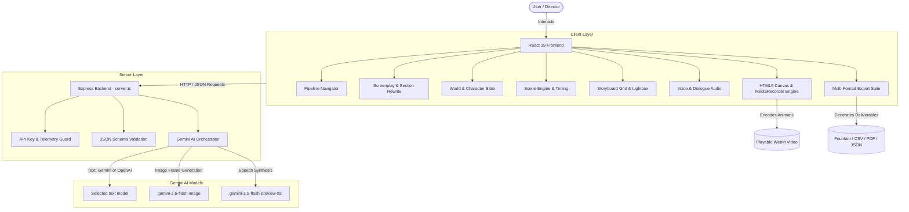

# SceneCraft

> **Turn an idea into a complete, structured content production pipeline.**

[](tests/)
[](tsconfig.json)
[](package.json)
[](LICENSE)

---

## Live Demo

- **Application URL**: [https://ais-dev-kkxb7ks27a5svkbrvivdvi-968640885885.asia-southeast1.run.app](https://ais-dev-kkxb7ks27a5svkbrvivdvi-968640885885.asia-southeast1.run.app)
- **Pre-Loaded Demo**: Explore the pre-loaded short film project *"The Last Signal"* without requiring an API key.

---

## Overview

Modern generative AI tools often treat content generation as disconnected chat prompts. A writer gets a script in one tab, copies snippets into an image generator in another tab where characters change face and clothing every frame, and is left with no coherent way to organize scenes, record voiceovers, or generate an animatic pitch.

**SceneCraft** solves this by establishing a disciplined, sequential **8-stage production pipeline**:

```
Idea → Project Config → Screenplay → World Bible → Scenes → Storyboard → Voice Audio → Video Assembly → Export
```

Every stage produces validated, structured data that directly feeds the next step, ensuring that character traits, recurring environments, camera directions, and timing remain consistent.

---

## System Architecture



---

## The 8 Pipeline Stages

| Stage | Name | Key Functionality |
| :--- | :--- | :--- |
| **01** | **Project Setup** | Configure title, premise, format (Short Film, YouTube, Ad, Animation), duration, tone, and visual style. |
| **02** | **Screenplay** | Generates title, logline, synopsis, and full screenplay with scene headers. Supports selective single-section rewrites. |
| **03** | **World Bible** | Extracts characters, recurring locations, and props. Stores visual prompt markers for cross-scene consistency. |
| **04** | **Scene Engine** | Breaks down screenplay into sequential scenes with camera directions, actions, dialogue, mood, and durations. Reorder scenes with automatic renumbering. |
| **05** | **Storyboard** | Multi-state visual grid (`idle`, `generating`, `completed`, `failed`). Generates frames with Gemini Image models, includes lightbox inspector and single-frame downloads. |
| **06** | **Voice Audio** | Optional voiceover & dialogue speech synthesis with 5 prebuilt Gemini TTS voices (Kore, Puck, Charon, Fenrir, Zephyr). Non-blocking. |
| **07** | **Video Assembly** | Real-time animatic player with Ken Burns movement and audio sync. Browser-side Canvas `MediaRecorder` compiles genuine `.webm` video files. |
| **08** | **Export Suite** | Fountain (`.fountain`), Markdown (`.md`), Plain Text, CSV scene breakdowns, printable PDF-ready storyboard, and full project backup JSON. |

---

## Tech Stack

- **Frontend**: React 19, TypeScript, Tailwind CSS, Lucide Icons, Vite
- **Backend / Server**: Node.js, Express, tsx
- **AI Providers**: Gemini, OpenAI, Anthropic Messages, and Hugging Face OpenAI-compatible text adapters; official `@google/genai` SDK for Gemini media generation
    - **Gemini text**: `gemini-2.5-flash`, `gemini-2.5-pro`
    - **OpenAI text**: `gpt-4.1-mini`, `gpt-4.1`, `o4-mini`
    - **Anthropic text**: Claude models from the authenticated model catalog
    - **Hugging Face text**: Qwen models and other models available through the HF Inference router
    - **Gemini image**: `gemini-2.5-flash-image`
    - **Gemini speech**: `gemini-2.5-flash-preview-tts`
- **Video Assembly**: HTML5 Canvas 2D, MediaStream Recording API (`MediaRecorder`), Web Audio API
- **Testing**: Node.js Native Test Runner (`node:test`, `node:assert/strict`)

---

## Getting Started

### Prerequisites
- Node.js `v20.x` or newer (`v22.x` recommended) and npm `v10.x` or newer.

### Fastest Codespaces Startup
The dev container installs the lockfile dependencies on creation and forwards port `3000`. In the Codespaces terminal, run:

```bash
npm run dev
```

Codespaces opens the forwarded app. The same process serves the Express API and Vite development UI; no second frontend process or proxy is needed. Readiness is available at `/api/health`.

### Local Startup
Install the locked dependencies once, then run the single full-stack server:

```bash
npm ci
npm run dev
```

Open `http://localhost:3000`. Without a key, the sample project and non-AI pipeline tools remain available in demo mode.

### Configure AI
Open **AI Settings** in the app header, choose Gemini, OpenAI, Anthropic, or Hugging Face, enter that provider's API key, and use **Test key** to verify provider access. Testing uses the provider's model-list endpoint; it does not generate content. Then save the provider, model, and thinking level. Qwen models are available through Hugging Face's inference router. Image and speech generation currently require Gemini; selecting another provider for text will not silently switch those requests.

You may instead configure server environment variables for unattended/headless startup. Copy `.env.example` to `.env` and set the provider's matching key (`GEMINI_API_KEY`, `OPENAI_API_KEY`, `ANTHROPIC_API_KEY`, or `HUGGINGFACE_API_KEY`/`HF_TOKEN`), optionally with `AI_PROVIDER`, `AI_MODEL`, and `PORT`. Environment keys are server-side defaults and are not returned to the browser.

---

## Running Tests & Verification

Automated tests cover pipeline data and mocked provider requests, credentials, model compatibility, thinking settings, retries, and malformed responses:

```bash
# Run unit test suite
npm test

# Run TypeScript linter
npm run lint

# Build for production
npm run build
```

---

## Environment Variables

| Variable | Required | Description |
| :--- | :--- | :--- |
| `GEMINI_API_KEY` | Optional | Gemini server-side fallback key. |
| `OPENAI_API_KEY` | Optional | OpenAI server-side fallback key. |
| `ANTHROPIC_API_KEY` | Optional | Anthropic server-side fallback key. |
| `HUGGINGFACE_API_KEY` / `HF_TOKEN` | Optional | Hugging Face server-side fallback token. |
| `AI_PROVIDER` | Optional | Default provider: `gemini` or `openai` (defaults to `gemini`). |
| `AI_MODEL` | Optional | Default text model, validated against the provider list. |
| `PORT` | Optional | Full-stack server port (defaults to `3000`). |

### Key Storage and Limits
Keys entered in the webpage are held only in server memory, associated with an opaque `HttpOnly`, `SameSite=Strict` browser-session cookie. They are not persisted to disk, returned by any endpoint, included in a URL, logged, or written to project/browser storage. They are lost when the server restarts; re-enter them after restart. Environment variables are the persistent alternative and should be configured through Codespaces secrets or the deployment secret manager, never committed to `.env`.

Generation settings also live in server memory for that browser session. The server caps a session at 10 AI requests per minute and 100 per day, limits text prompts to 100,000 characters, image prompts to 10,000 characters, audio input to 1,000 characters, and provider output to 8,192 tokens. These are guardrails, not a substitute for provider billing limits. AI generation can incur charges.

### Provider and Thinking Support
Gemini and Anthropic model selectors refresh against models enabled for the configured key; newer Gemini models (including `gemini-3.8-flash`) appear only if the provider catalog advertises them for that key. Hugging Face offers Qwen3 fallback models and refreshes from its inference router when available. Low, Medium, and High map to supported provider reasoning controls; unsupported models receive no reasoning parameter. The image and TTS pipeline stages are Gemini-only.

---

## Project Structure

```
├── server.ts                  # Express backend proxying Gemini AI calls securely
├── src/
│   ├── types/index.ts         # Canonical TypeScript interfaces (Project, Scene, WorldBible, etc.)
│   ├── services/
│   │   ├── api.ts             # Client API client calling Express backend
│   │   └── storage.ts         # Local persistence layer with autosave
│   ├── utils/
│   │   ├── promptBuilder.ts   # Consistency engine weaving World Bible into scene prompts
│   │   ├── videoRenderer.ts   # HTML5 Canvas + MediaRecorder video assembly engine
│   │   ├── exportUtils.ts     # Fountain, Markdown, CSV, and Printable Storyboard generators
│   │   └── sampleData.ts      # Pre-loaded "The Last Signal" short film demo project
│   ├── components/
│   │   ├── Header.tsx         # Workspace header, project switcher, save status indicator
│   │   ├── PipelineNav.tsx    # Sequential pipeline navigation bar
│   │   ├── ProjectModal.tsx   # Project configuration & settings modal
│   │   └── stages/
│   │       ├── ProjectOverview.tsx # Stage 01: Project overview & pipeline status
│   │       ├── ScriptStage.tsx     # Stage 02: Screenplay writer & section rewrite
│   │       ├── WorldBibleStage.tsx # Stage 03: World & Character Bible
│   │       ├── SceneStage.tsx      # Stage 04: Scene Engine & timing
│   │       ├── StoryboardStage.tsx # Stage 05: Visual Storyboard & image generator
│   │       ├── AudioStage.tsx      # Stage 06: Voice & speech synthesis studio
│   │       ├── VideoStage.tsx      # Stage 07: Video timeline & animatic assembler
│   │       └── ExportStage.tsx     # Stage 08: Export suite & archive manager
│   ├── App.tsx                # Master workspace coordinator
│   └── main.tsx               # Client entry point
├── tests/
│   └── pipeline.test.ts       # Automated unit test suite (node:test)
├── docs/
│   ├── architecture.md        # Technical architecture & design rationale
│   ├── pipeline.md            # Detailed pipeline stage specifications
│   ├── api.md                 # API endpoints & request/response schemas
│   └── PORTFOLIO.md           # Portfolio study, challenges, & solutions
├── CHANGELOG.md               # Version history
├── CONTRIBUTING.md            # Contribution guidelines
├── LICENSE                    # MIT License
└── package.json               # Dependencies & scripts
```

---

## Known Limitations

- **Image Generation Quota**: Live image generation requires a Gemini API key with access to `gemini-2.5-flash-image`. A fallback sample art mode is provided for offline/demo use.
- **Video Format**: Current in-browser video rendering exports WebM video files (`video/webm`). MP4 transcoding requires WebAssembly FFmpeg.
- **Audio Models**: Multi-speaker backchanneling is not implemented; single-speaker narration uses `gemini-2.5-flash-preview-tts`.
- **OpenAI Media**: OpenAI-compatible text generation is supported, but image and speech endpoints require Gemini and report this limitation without switching providers.
- **Session Key Persistence**: Web-entered keys are intentionally memory-only and are lost on server restart. Configure environment secrets when durable server-side configuration is required.

---

## Roadmap

- [ ] WebAssembly FFmpeg client-side transcoding to MP4 format.
- [ ] Multi-speaker dialogue generation with scripted vocal bursts and backchanneling.
- [ ] Google Veo video generation integration (`veo-3.1-lite-generate-preview`) for motion clips.
- [ ] Cloud workspace synchronization via PostgreSQL.

---

## License

This project is licensed under the [MIT License](LICENSE).
